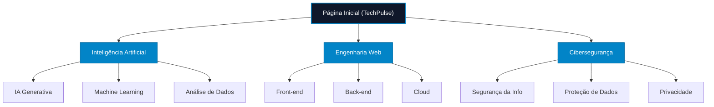

 # TechPulse — Portal de Notícias de Tecnologia

Página inicial do **TechPulse**, um portal simples e organizado para reunir novidades sobre inteligência artificial, desenvolvimento web e segurança digital.

## 1. Estrutura do Projeto

```text
techpulse-portal/
├── index.html             # Estrutura semântica da página
├── css/
│   └── style.css          # Estilos, cores e responsividade
├── img/
│   └── capa-techpulse.svg # Imagem principal do portal
└── README.md              # Documentação do projeto
```

## 2. Tecnologias Utilizadas

* **HTML5:** Estruturação semântica do conteúdo (`<header>`, `<nav>`, `<main>`, `<section>`, `<article>` e `<footer>`).
* **CSS3:** Estilização visual, organização de espaços e adaptação para celulares com **Flexbox** e **Media Queries**.
* **SVG:** Imagem vetorial leve e nítida em qualquer tamanho de tela.

## 3. Escolhas de Design

* **Cores:** Escolhi tons de azul para transmitir tecnologia e confiança, combinados com fundo claro para facilitar a leitura.

| Cor | Código | Onde foi usada |
| :--- | :--- | :--- |
| Azul-marinho | `#0F172A` | Cabeçalho e rodapé |
| Azul | `#0284C7` | Botões e bordas de destaque |
| Ciano | `#38BDF8` | Detalhes do logotipo e menu |
| Branco | `#FFFFFF` | Cartões de conteúdo |
| Cinza-claro | `#F8FAFC` | Fundo geral da página |

* **Letras (Tipografia):** Usei a fonte `Segoe UI` (com alternativas `Roboto` e `Arial`), por ser limpa, moderna e fácil de ler tanto no computador quanto no celular.
* **Espaços (Box Model):** Usei `padding` para dar respiro interno nos textos e botões, `border` para destacar os cartões e `margin` para separar cada seção da página.

## 4. Sitemap Visual, Hierarquia e Taxonomia

O portal organiza os assuntos em **3 níveis de hierarquia** e usa uma **taxonomia por categorias** (agrupando os temas por área) para facilitar a navegação:



* **Nível 1:** Página Inicial (apresentação e destaques).
* **Nível 2:** As 3 áreas principais do portal.
* **Nível 3:** Subcategorias específicas dentro de cada área.

---

**Projeto:** TechPulse (v1.0) | **Repositório:** [github.com/LopesZK/techpulse-portal](https://github.com/LopesZK/techpulse-portal)
